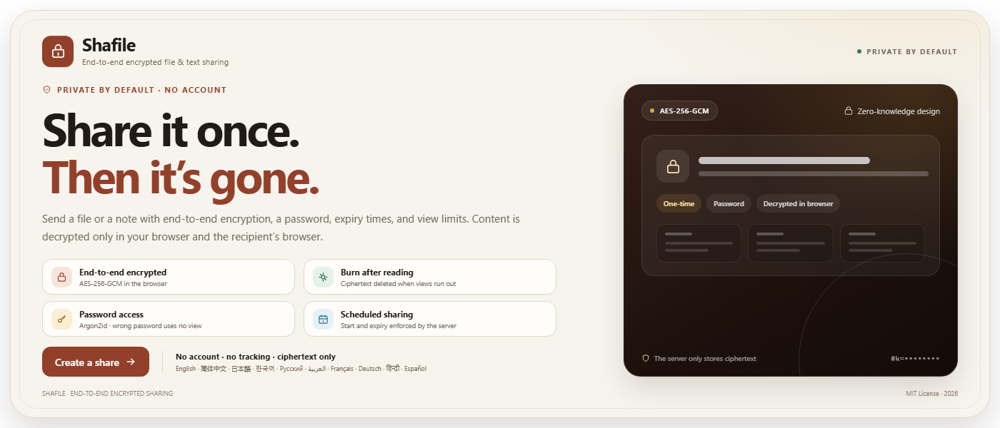

<center>

[English](README.md) · [简体中文](README.zh-CN.md) · [日本語](README.ja.md) · [한국어](README.ko.md) · [Русский](README.ru.md) · [العربية](README.ar.md) · [Français](README.fr.md) · [Deutsch](README.de.md) · **हिन्दी** · [Español (México)](README.es-MX.md)

**लाइव प्रीव्यू (Cloudflare Workers):** <https://shafile.laoju.wang>

</center>

## 1. परिचय

Shafile अंत-से-अंत एन्क्रिप्टेड फ़ाइल और टेक्स्ट शेयरिंग टूल है। सामग्री ब्राउज़र में एन्क्रिप्ट होती है और सर्वर केवल सिफरटेक्स्ट रखता है। यह व्यू सीमा, निर्धारित शुरुआत और समाप्ति, पासवर्ड एक्सेस और पढ़ने के बाद मिटाने का समर्थन करता है।

## 2. इंस्टॉलेशन और उपयोग

### आवश्यकताएँ

- Node.js 24+ (Node 26 पर परीक्षण)
- pnpm
- उत्पादन में HTTPS

### स्थानीय रूप से चलाएँ

```bash
pnpm install
pnpm dev
```

<http://localhost:3000> खोलें। पहली बार शुरू होने पर बनते हैं:

- `data/shafile.db`: SQLite मेटाडेटा
- `data/blobs/`: सिफरटेक्स्ट स्टोरेज
- `data/.secrets.json`: विकास के लिए साइनिंग सीक्रेट

### उपयोग कैसे करें

1. होम पर **बनाएँ** चुनें, टेक्स्ट लिखें या फ़ाइल चुनें।
2. एक्सेस मोड, शुरुआत/समाप्ति समय और व्यू सीमा सेट करें।
3. शेयर बनाकर लिंक कॉपी करें। पासवर्ड मोड में पासवर्ड अलग माध्यम से भेजें।
4. प्राप्तकर्ता ब्राउज़र में लिंक खोलकर डिक्रिप्ट करता है और सामग्री देखता या डाउनलोड करता है।

### उत्पादन परिनियोजन

```bash
pnpm build
pnpm start
```

Caddy या Nginx जैसे रिवर्स प्रॉक्सी को `127.0.0.1:3000` के आगे रखें और HTTPS सक्षम करें:

```caddyfile
shafile.example.com {
  reverse_proxy 127.0.0.1:3000
}
```

उत्पादन में `TICKET_SECRET` और `IP_HASH_SECRET` स्पष्ट रूप से सेट करें, और प्रॉक्सी के पीछे `TRUST_PROXY=true` रखें। `data/` का बैकअप लेने से पहले सेवा रोकें। ऐप अभी सिंगल-इंस्टेंस डिज़ाइन है (SQLite, इन-मेमोरी दर सीमा और सक्रिय डाउनलोड ट्रैकिंग)।

### Docker

रिपॉज़िटरी में मल्टी-स्टेज `Dockerfile` और `docker-compose.yml` शामिल हैं।

```bash
docker compose up --build -d
```

ऐप `http://localhost:3000` पर उपलब्ध है। डेटा `shafile-data` वॉल्यूम में रहता है। उत्पादन में `TICKET_SECRET` और `IP_HASH_SECRET` स्पष्ट रूप से सेट करें, और ज़रूरत के अनुसार सीमाएँ तथा `TRUST_PROXY` समायोजित करें। इमेज Next.js standalone आउटपुट का उपयोग करती है और `/api/health` हेल्थ चेक देती है।

### CI

GitHub Actions (`.github/workflows/ci.yml`) lint, टाइप जाँच, i18n जाँच, यूनिट टेस्ट, उत्पादन बिल्ड, Playwright E2E और Docker इमेज बिल्ड चलाता है।

### Cloudflare

दो डिप्लॉयमेंट विकल्प समर्थित हैं।

- [Cloudflare Tunnel](docs/cloudflare.md): Node.js, SQLite, स्थानीय डिस्क, स्ट्रीमिंग और क्लीनअप बनाए रखता है।
- [Workers + D1 + R2](docs/cloudflare-workers.md): Cloudflare पर पूरी तरह serverless, लेकिन Workers, D1 और R2 कोटा सीमाओं के साथ।

### पर्यावरण चर

| चर | डिफ़ॉल्ट | विवरण |
| --- | --- | --- |
| `SHAFILE_DATA_DIR` | `./data` | डेटा रूट |
| `DATABASE_PATH` | `$DATA_DIR/shafile.db` | SQLite पथ |
| `BLOB_DIR` | `$DATA_DIR/blobs` | सिफरटेक्स्ट डायरेक्टरी |
| `TICKET_SECRET` | स्वतः बनाया | एक्सेस टोकन HMAC सीक्रेट |
| `IP_HASH_SECRET` | स्वतः बनाया | दर सीमा IP हैश सीक्रेट |
| `MAX_SHARE_BYTES` | 5 GiB | प्रति फ़ाइल सीमा |
| `MAX_STORAGE_BYTES` | 50 GiB | कुल स्टोरेज सीमा |
| `TRUST_PROXY` | `false` | रिवर्स प्रॉक्सी के पीछे `true` |
| `CRON_SECRET` | — | Cloudflare आंतरिक क्लीनअप सीक्रेट |

### कमांड

```bash
pnpm dev          # विकास सर्वर
pnpm build        # उत्पादन बिल्ड
pnpm start        # उत्पादन सर्वर
pnpm lint         # ESLint
pnpm typecheck    # TypeScript
pnpm test         # यूनिट टेस्ट
pnpm test:e2e     # Playwright E2E टेस्ट
pnpm i18n:check   # संदेश कुंजी और प्लेसहोल्डर जाँच
pnpm cf:build     # Cloudflare Worker build
pnpm cf:preview   # Local D1/R2 preview
pnpm cf:deploy    # Deploy Worker
```

Playwright के पहले उपयोग के लिए `pnpm exec playwright install chromium` आवश्यक है। बड़ी फ़ाइलों की स्ट्रीमिंग डाउनलोड Chrome और Edge जैसे Chromium ब्राउज़र में सबसे अच्छी रहती है। अन्य ब्राउज़र 256 MiB सीमा के साथ मेमोरी में डिक्रिप्शन करते हैं।

## 3. एन्क्रिप्शन प्रकटीकरण

### दायरा

Shafile अपलोड से पहले ब्राउज़र में फ़ाइल और नोट की सामग्री एन्क्रिप्ट करता है। सर्वर केवल सिफरटेक्स्ट, एन्क्रिप्टेड मेटाडेटा और एक्सेस नियम लागू करने के लिए आवश्यक न्यूनतम ऑपरेशनल मेटाडेटा रखता है।

### क्रिप्टोग्राफ़िक प्रिमिटिव

- **सामग्री एन्क्रिप्शन**: Web Crypto API के माध्यम से AES-256-GCM।
- **पासवर्ड KDF**: Argon2id, 64 MiB मेमोरी, 3 पुनरावृत्तियाँ, 1 लेन और 32-बाइट आउटपुट।
- **कुंजी व्युत्पत्ति**: HKDF-SHA-256, डोमेन अलगाव के साथ (`shafile/v1/wrap`, `shafile/v1/auth`)।
- **अखंडता**: AES-GCM प्रमाणीकरण टैग और प्लेनटेक्स्ट manifest पर SHA-256।

### कुंजी प्रबंधन

- **लिंक मोड**: यादृच्छिक 32-बाइट सामग्री कुंजी URL फ़्रैगमेंट (`/s/{id}#k=...`) में एन्कोड होती है। फ़्रैगमेंट सर्वर को नहीं भेजे जाते।
- **पासवर्ड मोड**: सामग्री कुंजी को पासवर्ड से व्युत्पन्न कुंजी से लपेटा जाता है। सर्वर केवल salt, लिपटी कुंजी, nonce, KDF पैरामीटर और पासवर्ड प्रमाणीकरण कुंजी का सत्यापनकर्ता रखता है; उसे पासवर्ड या सामग्री कुंजी कभी नहीं मिलती।
- पासवर्ड दो डोमेन-पृथक मान बनाता है: प्राधिकरण के लिए `authKey` और खोलने के लिए `wrapKey`। `authKey` जानने से सामग्री डिक्रिप्ट नहीं हो सकती।

### फ़ाइल फ़ॉर्मेट

```
header   = "SHF1" | chunkSize(u32) | noncePrefix(8B) | fileId(16B)
part[i]  = len(u32) | AES-GCM(plaintextChunk_i)
manifest = len(u32) | AES-GCM(JSON{name,mime,size,sha256,chunkCount})
```

हर चंक का nonce `noncePrefix || u32be(index)` है। AAD हेडर हैश, शेयर आईडी, चंक इंडेक्स और अंतिम-चंक फ़्लैग को बाँधता है। फ़ाइल नाम, MIME प्रकार, आकार, SHA-256 और चंक संख्या एन्क्रिप्टेड manifest में रहते हैं। टेक्स्ट उसी सामग्री कुंजी के साथ एकल AES-GCM रिकॉर्ड का उपयोग करता है।

### एक्सेस नियंत्रण और सर्वर दृश्यता

सर्वर सिफरटेक्स्ट का आकार, निर्माण और पहुँच समय, पहुँच संख्या, समय सीमा, पासवर्ड की मौजूदगी और व्यू सीमा देख सकता है। वह फ़ाइल नाम, सामग्री, पासवर्ड या कुंजियाँ नहीं देख सकता। शुरुआत, समाप्ति और व्यू सीमाएँ परमाणु रूप से लागू होती हैं; शेयर खत्म, रद्द या समाप्त होने पर सिफरटेक्स्ट हटा दिया जाता है।

### सुरक्षा सीमाएँ

- प्राप्तकर्ता डिक्रिप्ट की गई सामग्री को कॉपी, स्क्रीनशॉट या आगे भेज सकता है। यह DRM नहीं है।
- लिंक कुंजी ब्राउज़र इतिहास, क्लिपबोर्ड, QR कोड, स्क्रीनशॉट या प्राप्तकर्ता के लॉग से लीक हो सकती है।
- XSS या दुर्भावनापूर्ण ब्राउज़र एक्सटेंशन डिक्रिप्ट की गई सामग्री पढ़ सकते हैं। प्रोजेक्ट CSP, तृतीय-पक्ष स्क्रिप्ट न होने और सख्त Markdown सैनिटाइज़ेशन से जोखिम कम करता है।
- एक समझौता किया गया सर्वर संशोधित क्लाइंट कोड दे सकता है; यह वेब के माध्यम से दिए जाने वाले अंत-से-अंत एन्क्रिप्शन की अंतर्निहित सीमा है।
- स्वतंत्र सुरक्षा ऑडिट का दावा नहीं किया जाता।

---

MIT License · Copyright (c) 2026 Wang Laoju
